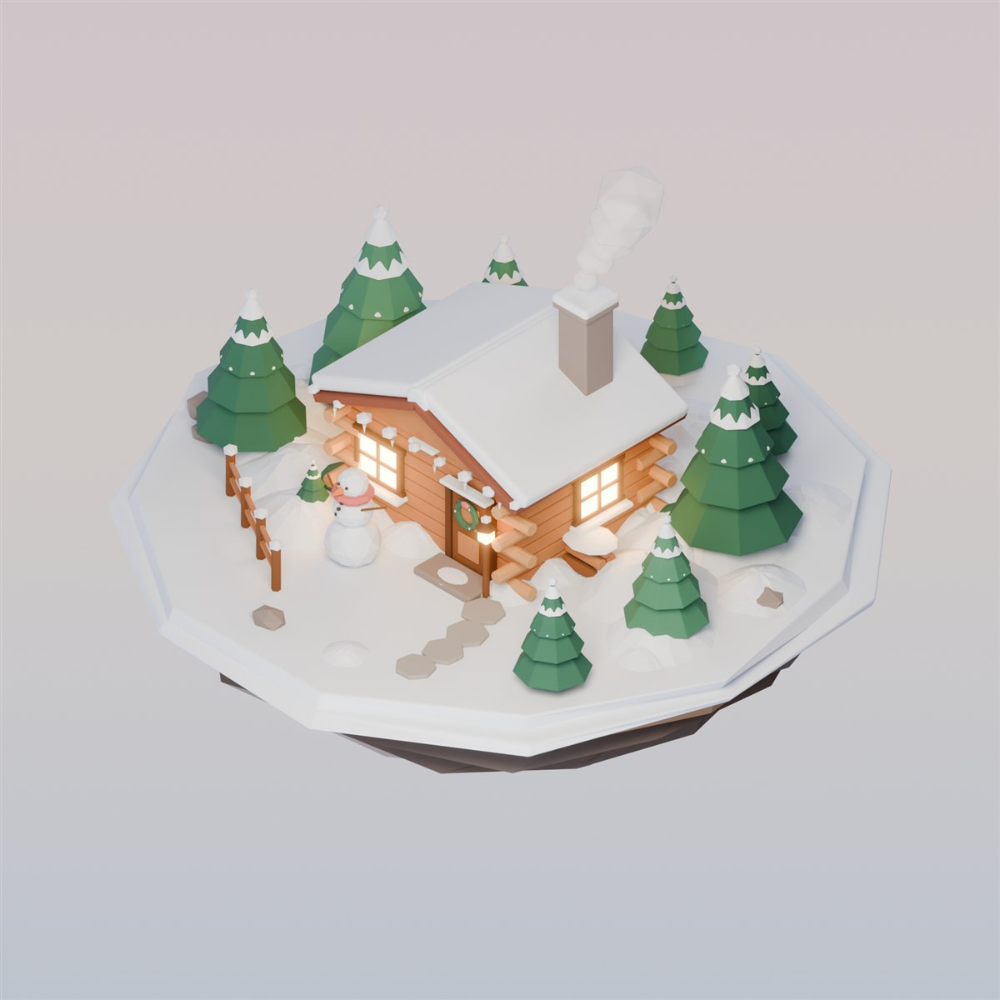

# ❄️ Winter Cabin — 360° 3D Diorama

### ▶ **Live demo: <https://caronyang.github.io/winter-cabin/>**

[English](#english) · [中文](#中文)

---

## English

A cozy, isometric low-poly diorama of a snowy wooden cabin — modelled procedurally in **Blender 4.5**, rendered with **Cycles**, exported to glTF and turned into an interactive 360° scene with **three.js**.

Orbit around the floating island, change the time of day, and let it snow.

### Highlights
- **360° orbit** with damped controls and an isometric default view
- **Day / Dusk / Night** — sky, lights, exposure, window glow, stars and moon all transition smoothly
- **Light / Heavy snowfall** — snow falls in a column around the diorama, not across the whole screen
- **Generative Christmas piano** — a light 8-bar piece in C major (104 BPM) with soft sleigh bells, synthesised live with Web Audio. No audio files, no licensing issues. On by default, one click to mute
- **Save snapshot** — exports the current view as a PNG
- Everything built from simple primitives: log walls, thick roof snow, icicles, snow-covered pines, a fence, stepping stones, a snowman and a smoking chimney

### Controls
| Action | Result |
|---|---|
| Drag / one finger | Orbit |
| Scroll / pinch | Zoom |
| Right-drag / two fingers | Pan |
| Bottom bar | Auto-rotate · Reset view · Save image · Music |
| Top-right | Time of day · Snowfall |

### Built with
`Blender 4.5` · `Cycles (OptiX)` · `glTF` · `three.js r170` · `Web Audio API`

No external assets: the model is procedural and the music is generated in the browser. Background music is intentionally quiet — use the **Music** button to turn it off.

---

## 中文

一個溫馨的等角 low-poly 雪景微縮模型：木屋、厚雪屋頂、雪松、柵欄、雪人與冒煙的煙囪，全部用 **Blender 4.5** 程序化建模、**Cycles** 算圖，再匯出 glTF，用 **three.js** 做成可以 360° 環繞的互動場景。

拖曳就能繞著小島看，也可以切換時段、調整雪量。

### 特色
- **360° 環繞**，預設等角視角，阻尼滑順
- **白天 / 黃昏 / 黑夜**：天空漸層、燈光、曝光、窗光、星空與月亮都會平滑過渡
- **小雪 / 大雪**：雪只落在微縮島上方與周圍，不會佈滿整個畫面
- **程序化聖誕鋼琴**：C 大調、104 BPM 的 8 小節輕快旋律，加上柔和雪橇鈴聲，用 Web Audio 即時合成，沒有音檔也沒有版權問題；預設開啟，一鍵可關
- **儲存圖片**：把目前視角存成 PNG
- 全部由基本幾何組成：原木牆、厚雪屋頂、冰柱、雪松、柵欄、踏石、雪人與冒煙煙囪

### 操作
| 動作 | 功能 |
|---|---|
| 拖曳 / 單指 | 旋轉 |
| 滾輪 / 雙指 | 縮放 |
| 右鍵拖曳 / 雙指 | 平移 |
| 下方按鈕 | 自動旋轉 · 重設視角 · 儲存圖片 · 音樂 |
| 右上方 | 時段 · 雪量 |

### 技術
`Blender 4.5` · `Cycles (OptiX)` · `glTF` · `three.js r170` · `Web Audio API`

沒有任何外部素材：模型是程序化生成，音樂是在瀏覽器即時合成。背景音量刻意壓低，需要安靜時按一下 **音樂** 即可關閉。
